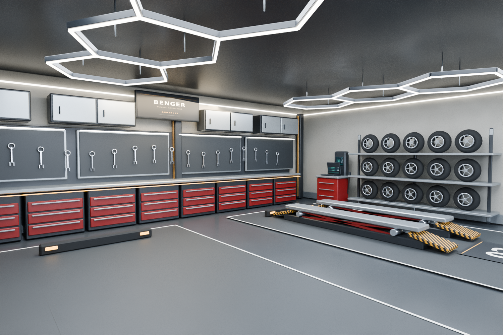

# Benger Garage v2 — GTA SA / MTA

**[Pobierz poprawioną paczkę v2 do MTA](https://github.com/igore0505-dot/benger/raw/refs/heads/main/benger_garage_v2_MTA.zip)**

[Otwórz plik ZIP na GitHubie](benger_garage_v2_MTA.zip) i użyj „Download raw file”, jeśli pobieranie nie zacznie się automatycznie.

## Co zawiera v2

- Drzwi przesuwne skopiowane z oryginalnego modelu: geometria, UV, szkło, ramy i uchwyty. Dwa ruchome skrzydła z własną kolizją i automatycznym otwieraniem.
- Wejście do garażu na środku prawej ściany, otoczone drewnianymi lamelami. Lamele odtworzono ze zdjęcia; nie było ich w źródłowych modelach.
- Nowa dobudówka około 15 × 12,8 m: dwa stanowiska, podnośnik nożycowy, posadzka żywiczna, bramy wjazdowe podniesione na stałe.
- Oświetlenie sześciokątne, zabudowa warsztatowa, szafki i narzędzia, regał z kołami, kompresor, ładowarki oraz stanowisko diagnostyczne.
- 16 nowych tekstur z mipmapami i wszystkie 53 oryginalne tekstury.

[Podgląd drzwi i przejścia](drzwi_v2.png) · [Widok całej dobudówki](calosc_v2.png) · [Edytowalny plik Blendera](https://github.com/igore0505-dot/benger/raw/refs/heads/main/BengerGarage_v2.blend)

## Uruchomienie w MTA 1.6

1. Rozpakuj folder `benger_garage_v2` do katalogu `resources` serwera.
2. Zatrzymaj starą wersję: `stop benger_garage`.
3. Wykonaj `refresh`, a następnie `start benger_garage_v2`.
4. W grze, na pustym i płaskim terenie, wpisz `/benger`.
5. Podejdź do szklanych drzwi po prawej stronie wnętrza — otwierają się automatycznie. `/bengerdrzwi` przełącza tryby, `/bengerusun` usuwa podgląd.

Podgląd jest lokalny dla gracza. Stałe umieszczenie na wspólnej mapie wymaga ustawienia współrzędnych oraz synchronizacji po stronie serwera; instrukcja jest w paczce.

## Sprawdzenie

Wszystkie pięć DFF, tekstury i trzy COL przechodzą kontrolę odczytu i geometrii. Potwierdzono zgodność drzwi z oryginałem, wolne przejście po otwarciu i blokowanie przez zamknięte skrzydła. Logika Lua przeszła testy z atrapami API MTA, w tym zmianę kierunku animacji i obrót budynku.

Modele nie były uruchamiane w kliencie GTA/MTA. Podglądy są renderami Blendera; oświetlenie i odbicia w grze będą się różnić. Shader LED utrzymuje jasne listwy, ale nie oświetla sąsiednich powierzchni.
