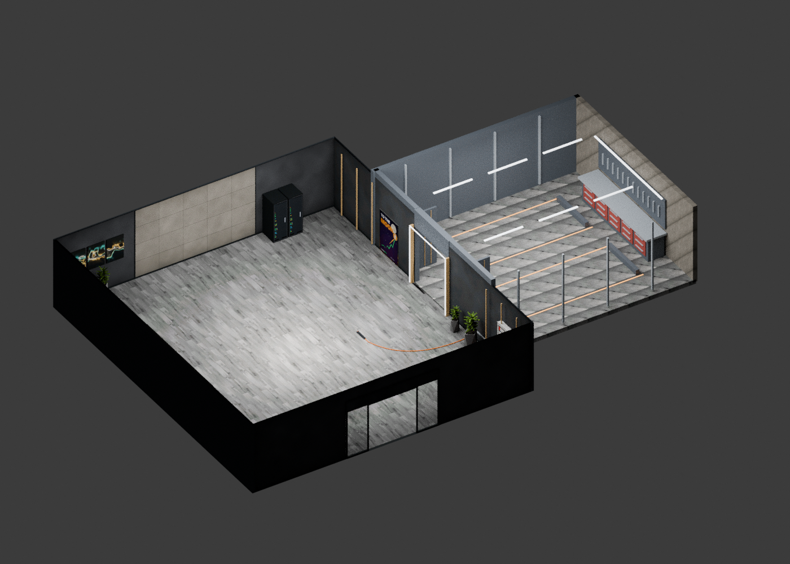

# Benger Garage — GTA SA / MTA

[Pobierz paczkę ZIP](https://github.com/igore0505-dot/benger/raw/refs/heads/main/benger_garage_MTA.zip)

Paczka zawiera dwa modele DFF, wspólny TXD, uproszczoną kolizję COL oraz resource do podglądu w MTA 1.6.

## Instalacja

1. Rozpakuj ZIP i umieść folder `benger_garage` w katalogu `resources` serwera MTA.
2. W konsoli serwera wykonaj `refresh`, następnie `start benger_garage`.
3. W grze wpisz `/benger`. Podgląd pojawi się 30 metrów w kierunku +Y. Wybierz puste, płaskie miejsce.
4. `/bengerusun` usuwa lokalny podgląd.

Podgląd jest widoczny wyłącznie dla gracza uruchamiającego komendę. Stałe, wspólne mapowanie wymaga dostosowania skryptu.

## Stan projektu

Pierwsza wersja projektowa: dobudowany garaż na dwa auta, otwarte statyczne drzwi, stanowisko warsztatowe, szafki i listwy oświetleniowe. Render pokazuje przekrój bez dachu i jednej ściany; kompletna geometria jest w modelach.

Sprawdzono odczyt wyeksportowanych DFF, dostępność tekstur i odczyt COL. Model nie był testowany w kliencie GTA/MTA. Dokładne położenie wejścia i kolizję należy sprawdzić w grze. Emisja światła z renderu Blendera nie przenosi się automatycznie do GTA.
