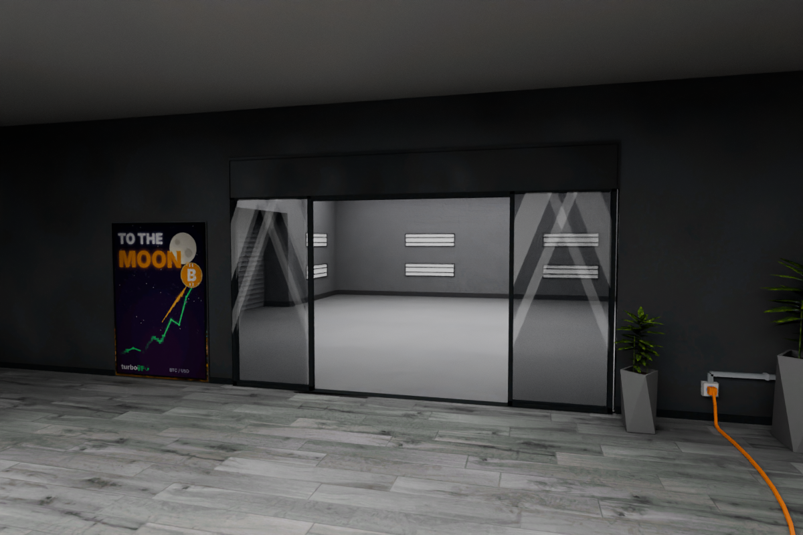

# Oryginalne wnętrze + drzwi + Twój garaż

**[Pobierz aktualną paczkę do MTA](https://github.com/igore0505-dot/benger/raw/refs/heads/main/oryginal_drzwi_twoj_garaz_MTA.zip)**

[Plik ZIP na GitHubie — Download raw file](oryginal_drzwi_twoj_garaz_MTA.zip)

Przywrócono początkowe modele `Obje` i `crypto_garaz_extra`. Dodano tylko przejście w prawej ścianie i przesuwne drzwi skopiowane z oryginalnego wejścia.

Za nimi znajduje się garaż z przesłanych **1.dff, 1.col i 1.txd**. Ustawiono go w pionie i wyrównano poziom podłogi bez zmiany skali. Wycięto wyłącznie otwór łączący oba wnętrza. Nie dodano mojego wystroju ani wyposażenia. Tekstury garażu są identyczne z załącznikiem.

[Wnętrze Twojego garażu](zalaczony_garaz.png) · [Połączenie obu modeli](oryginal_polaczenie.png) · [Plik Blendera](https://github.com/igore0505-dot/benger/raw/refs/heads/main/Oryginal_plus_Twoj_garaz.blend)

## Uruchomienie w MTA 1.6

1. Rozpakuj `benger_original_garaz` do katalogu `resources`.
2. Zatrzymaj wcześniejsze wersje: `stop benger_garage_v2` oraz `stop benger_garage`.
3. Wykonaj `refresh`, potem `start benger_original_garaz`.
4. Na płaskim, pustym terenie wpisz `/benger`.

Drzwi rozsuwają się przy podejściu; `/bengerdrzwi` przełącza tryby, `/bengerusun` usuwa lokalny podgląd. Stała mapa współdzielona wymaga ustawienia współrzędnych i synchronizacji serwerowej.

Sprawdzono geometrię, UV, tekstury, połączenie podłóg, kolizję przejścia i logikę Lua poza grą. Test w kliencie MTA pozostaje do wykonania. Obrazy są renderami Blendera.
